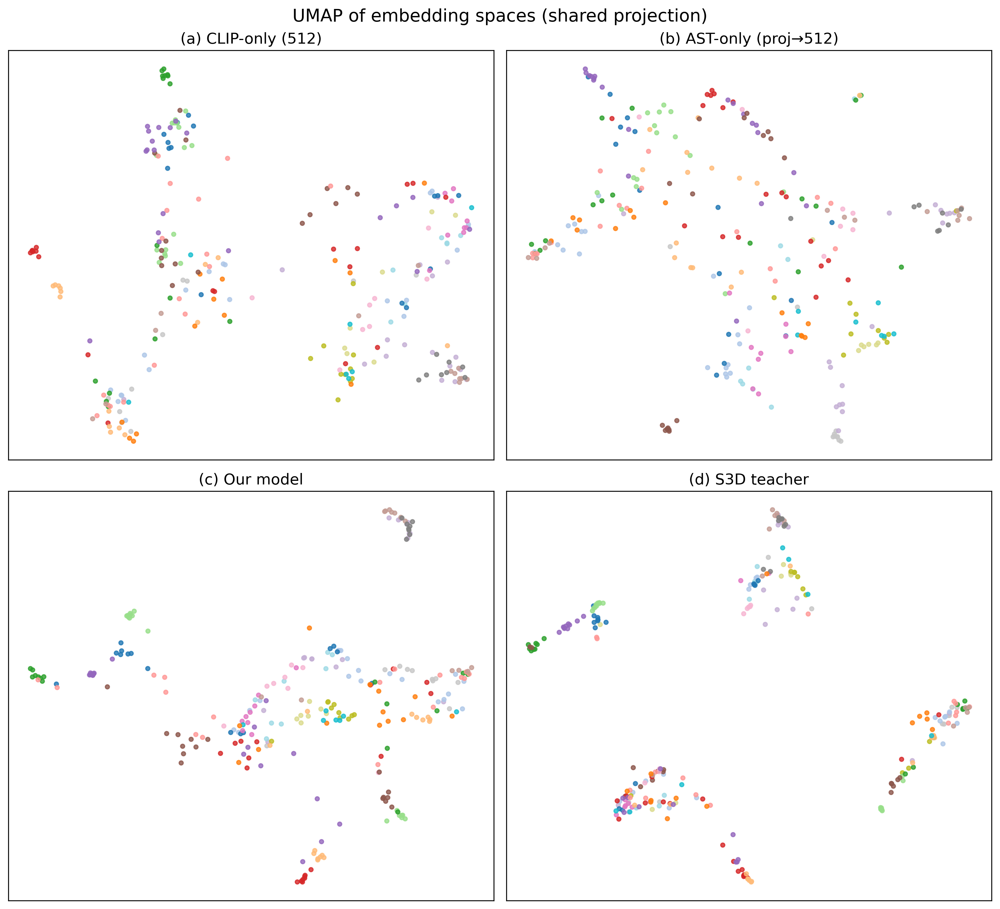
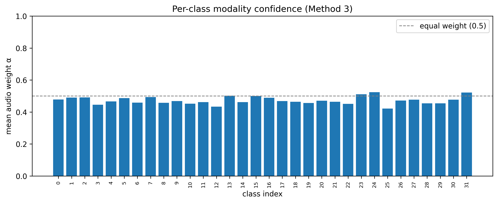

# Audio-Visual Semantic Distillation

Approximating a full-video semantic embedding from a single still frame and the
clip's audio, instead of processing every frame through a heavy video model.

We take frozen image (CLIP) and audio (AST) encoders and train a small network to
map their combined output into the embedding space of a frozen full-video model
(S3D MIL-NCE), which serves as a teacher. We then measure how well those
synthesized embeddings work for cross-modal retrieval.

## Results

Evaluated on a 32-class, 1,027-clip subset of Kinetics-Sounds (764 train / 263 test).

| Method | R@1 | R@5 | R@10 | MedR | Cosine | Params |
|---|---|---|---|---|---|---|
| Latent-space regression (Baseline 1) | 6.84 | 29.28 | 47.15 | 12 | 0.646 | 2.10M |
| Contrastive alignment (Method 1) | 31.18 | 69.96 | 84.79 | 3 | 0.321 | 2.10M |
| **Cross-modal distillation (Method 2)** | **42.21** | **79.09** | **89.35** | **2** | 0.324 | 3.02M |
| Distillation + soft weighting (Method 3) | 37.26 | 73.76 | 88.59 | 2 | 0.330 | 2.76M |
| Distillation + hard gate (ablation) | 26.24 | 63.12 | 77.19 | 3 | 0.306 | 2.76M |
| ImageBind zero-shot, image to audio (Baseline 2) | 34.85 | 67.42 | 75.76 | 3 | 0.301 | 1.2B |
| ImageBind zero-shot, audio to image (Baseline 2) | 38.26 | 72.35 | 84.09 | 2 | - | 1.2B |

Higher is better for recall and cosine; lower is better for median rank.

The cross-modal distillation model reaches 42.2% top-1 retrieval with about 3M
trainable parameters, ahead of ImageBind's zero-shot audio-visual retrieval while
being roughly 400x smaller. Across every comparison, the training objective was the
single largest factor: switching from regression to a contrastive loss, with no
change to the network, lifted top-1 from 6.8% to 31.2%.

Note on the ImageBind comparison: the trained models retrieve the S3D video
embedding from frame+audio input, while ImageBind is reported on its native
image-audio retrieval (it was never trained to match the S3D space). It is a
reference point rather than a strict head-to-head, measured on the same test clips.

### Embedding space



*A 2-D UMAP view of the test-set embeddings: (a) image only, (b) audio only,
(c) our distillation model, (d) the S3D teacher, colored by class. Our model's
output (c) forms tighter class clusters than the raw unimodal inputs and resembles
the teacher's structure (d), despite using only one frame plus audio.*

### Learned modality weights (Method 3)



*The average audio weight learned for each class by Method 3. The weights vary only
mildly around equal weighting (range 0.42-0.52, slight visual lean), which is
consistent with Method 3 not improving over plain distillation: the modality-routing
signal is real but too weak to help at this data scale.*

## Trained weights

All five trained checkpoints are available here:
https://drive.google.com/drive/folders/1wWjjiCtTnhQ1_MqgufWGK72MSqe7dSqN?usp=sharing

(They are also under `checkpoints/` in this repo.)

## Repository layout

```
config.py                          dimensions, paths, hyperparameters
data/
  dataset.py                       AudioVisualDataset (reads cached embeddings)
  extract_clip.py                  CLIP ViT-B/32 frame embeddings
  extract_ast.py                   AST audio embeddings
  merge_embeddings.py              intersect and sanity-check the caches
models/
  baseline_regression.py          Baseline 1 (MLP + MSE/cosine)
  contrastive_alignment.py         Method 1 (same MLP, InfoNCE)
  cross_modal_distillation.py      Method 2 (cross-attention + CRD)
  asymmetric_distillation.py       Method 3 (softmax modality weighting)
  asymmetric_gate.py               Method 3 hard-gate ablation
losses/
  losses.py                        mse_cosine, infonce, crd (with relational term)
train/
  train.py                         unified training loop
eval/
  retrieval_eval.py                R@K, MedR, cosine (with a self-test)
  efficiency_eval.py               parameters, FLOPs, latency
  imagebind_eval.py                ImageBind zero-shot baseline
utils/
  seed.py                          deterministic seeding
  visualize.py                     UMAP panels and modality-weight chart
results/                           training logs, efficiency table, figures
checkpoints/                       trained model weights
```

## Setup

```bash
python -m venv .venv
source .venv/bin/activate
pip install -r requirements.txt
```

## How it works

The encoders are frozen and never trained. Embeddings are extracted once and cached,
so training reads only cached tensors and never runs the heavy encoders in the loop.

1. Extract per-clip embeddings and place them under `data/cache/`:
   - `s3d_index.json` — the clip list with labels and splits
   - `clip_embeddings.pt` — CLIP image vectors (512-d)
   - `ast_embeddings.pt` — AST audio vectors (768-d)
   - `s3d_embeddings/` — per-clip S3D teacher vectors (512-d), the retrieval targets
2. Train each model variant.
3. Evaluate retrieval and efficiency, and generate the figures.

## Reproducing the results

With the cache in place:

```bash
# train each variant (writes results/training_log_<model>.csv + checkpoints/best_<model>.pt)
python train/train.py --model regression
python train/train.py --model contrastive
python train/train.py --model distillation
python train/train.py --model asymmetric
python train/train.py --model asymmetric_gate

# efficiency (parameters, FLOPs, latency)
python eval/efficiency_eval.py

# figures (UMAP panels + per-class modality weights), from the trained checkpoints
python utils/visualize.py
```

The ImageBind zero-shot baseline is run separately (it needs the raw frames and
audio rather than the cached vectors); see `eval/imagebind_eval.py`.

## Evaluation

Three dimensions are reported:

- **Latent-space proximity** — cosine similarity to the teacher embedding (and MSE
  for the regression baseline).
- **Retrieval** — Recall@1/5/10 and median rank.
- **Efficiency** — trainable parameters, FLOPs of the trainable head, and inference
  latency per clip, against the cost of full-video processing.

`eval/retrieval_eval.py` includes a self-test: feeding identical query and target
embeddings must return 100% top-1 retrieval, which confirms the metric code is
correct.

## Dataset

Kinetics-Sounds, the 32-class subset of Kinetics where both audio and vision are
informative. Clips were sourced from YouTube; after a resilient extraction pass that
handles takedowns, missing audio, and decode failures, and after balancing one
over-represented class, 1,027 clips have all three embeddings present (764 train,
263 test). The raw video cache is not included (it is large and regenerable); the
extraction scripts reproduce it.

## Requirements

See `requirements.txt`. Main dependencies: PyTorch, torchaudio, OpenAI CLIP,
Hugging Face Transformers (for AST), librosa, umap-learn, scikit-learn, matplotlib,
fvcore. Training and evaluation run on Apple Silicon (MPS), CUDA, or CPU.
